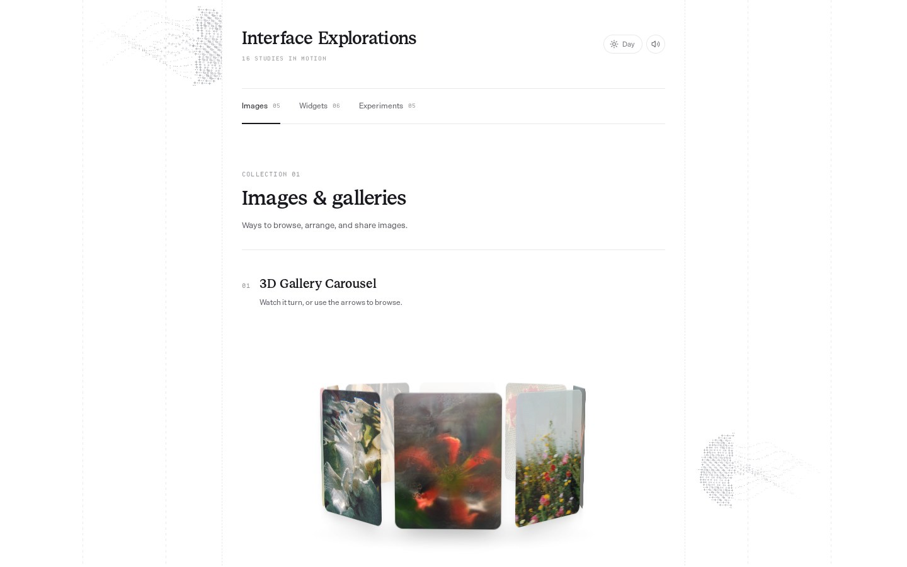

# Interaction Playground

Interface Explorations is a gallery of 16 interactive UI studies built with React, TypeScript, and Motion. Browse image galleries, flip cards, switch layouts, and try animated controls in light and dark themes.

[Open Interaction Playground](https://interaction-playground.ericzwierzynski.dev)



## How it works

The studies are grouped into Images, Widgets, and Experiments. Each is playable in place. Shared controls handle theme, sound, and autoplay. Calls and music controls simulate their interfaces.

## Run locally

Use Node.js 22.12 or later and npm.

```sh
npm ci
npm run dev
```

Open the URL Vite prints, starting at port 5174. Use `npm run build` for a production build.

[Implementation notes and asset sources](docs/implementation.md)
